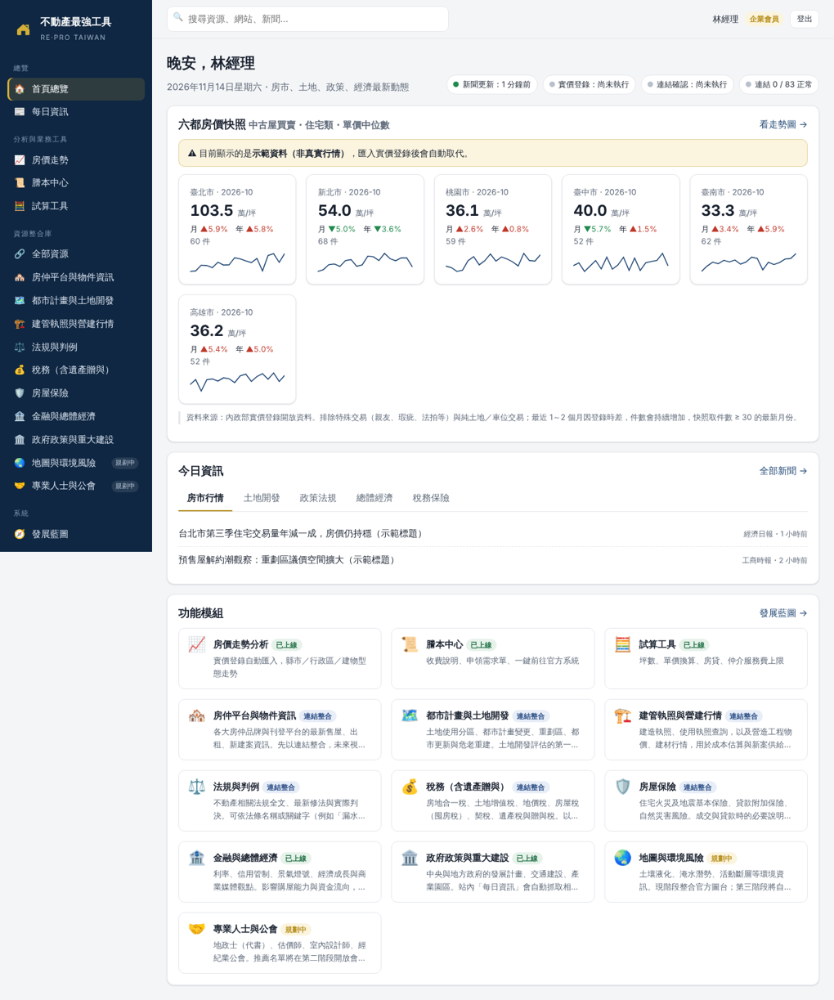
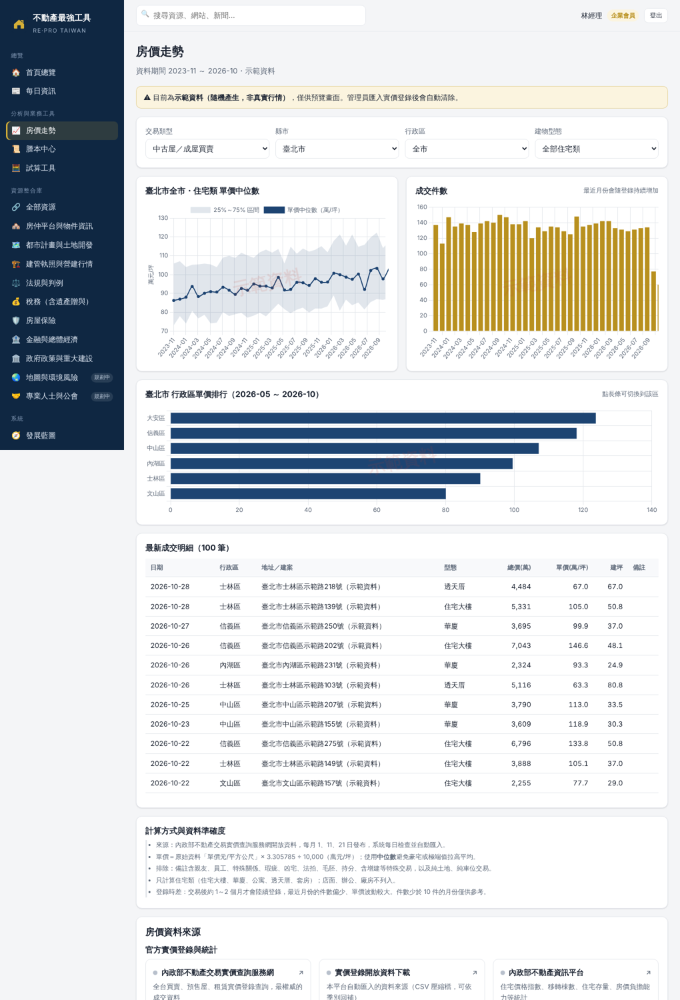
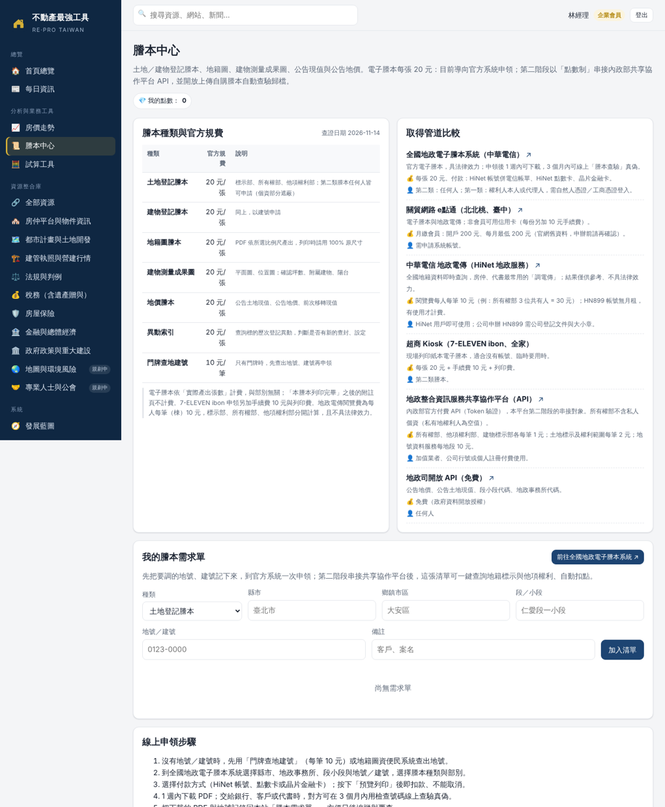
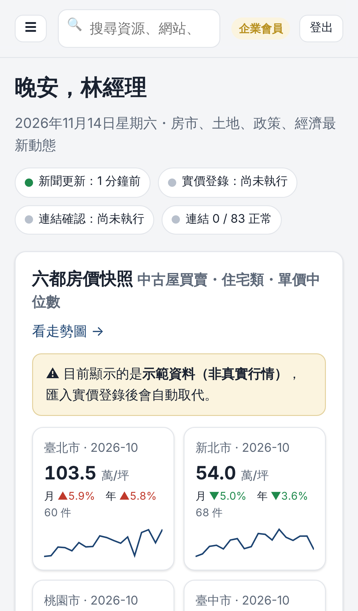

# 不動產最強工具（RE·PRO TAIWAN）

給房仲、地政士（代書）、開發商、土地開發業者的**會員制**資訊整合平台。
原則是「**先串接、後自建**」：能連結或下載官方資料的，就不自己做；每個資料都標明來源、可信度、更新頻率與費用。

## 第一階段已完成的功能

| 功能 | 說明 |
|---|---|
| 🔐 會員制 | 帳號密碼登入；註冊後待管理員審核，或用邀請碼直接開通。方案分基本、專業、企業三級，可設到期日，到期後自動降回基本會員權限。另有點數帳本，供日後謄本扣點使用。 |
| 🏠 首頁總覽 | 六都房價快照（單價中位數、月增率、年增率、走勢小圖）、今日新聞（5 類）、資料更新狀態、各功能入口 |
| 📰 每日資訊 | 每 3 小時自動抓取房市、土地開發、政策法規、總體經濟、稅務保險新聞；只存標題與原文連結 |
| 📈 房價走勢（專業會員） | 每天自動檢查並匯入內政部**實價登錄開放資料**，可依縣市、行政區、建物型態、預售或成屋查看走勢、成交量、行政區排行與最新成交明細 |
| 📜 謄本中心 | 各類謄本官方規費、各取得管道比較、申領步驟、常見問題、「謄本需求單」；點數制串接架構已預留 |
| 🔗 資源整合庫 | 12 大類、83 個精選來源，每天自動「**連結確認**」，失效連結會被標示 |
| 🧮 試算工具 | 坪與平方公尺換算、實價登錄單價換算、房貸試算、仲介服務報酬上限 |
| ⚙️ 管理後台 | 會員審核、方案與點數調整、邀請碼、排程手動執行、實價登錄歷史資料回補與上傳、連結確認報表 |

12 大類：房價與實價登錄、房仲平台與物件、謄本與地籍、都市計畫與土地開發、建管執照與營建行情、法規與判例、稅務（含遺產贈與）、房屋保險、金融與總體經濟、政府政策與重大建設、地圖與環境風險、專業人士與公會。

## 快速開始

需要 **Node.js 22.13 以上**，用內建的 SQLite，不需另外安裝資料庫。

```bash
cd re-pro-tw
npm install
cp .env.example .env                       # 視需要修改設定
npm run create-admin -- you@example.com 你的密碼123 你的名字
npm start                                  # 開啟 http://localhost:3000
```

想在匯入真實資料前先看看圖表，可以執行 `npm run demo-data` 產生示範資料。示範資料的數字是隨機產生的，畫面會清楚標示「示範資料（非真實行情）」；匯入真實實價登錄後，示範資料會自動清除。

### 常用指令

| 指令 | 用途 |
|---|---|
| `npm start` | 啟動網站（含每日自動排程） |
| `npm test` | 執行自動測試 |
| `npm run update-news` | 立即抓新聞 |
| `npm run check-links` | 立即做連結確認 |
| `npm run import-lvr` | 立即匯入本期實價登錄；指定季別用 `node scripts/run-job.js lvr 114S2` |
| `npm run demo-data` / `npm run demo-data -- --clear` | 產生或清除示範資料 |

### 部署

主機需要能連到外部網站，才能抓新聞、下載實價登錄、做連結確認。

- 任何能跑 Node.js 的主機都可以，例如 VPS、Render、Railway、Fly.io，或用附上的 `Dockerfile`。
- 正式環境請設定 `NODE_ENV=production`，並且一定要用 HTTPS。
- `storage/` 資料夾就是資料庫，請放在永久磁碟上並定期備份。

## 資料夾結構

```
re-pro-tw/
├─ server.js                  網站入口（安全標頭、會員導向、靜態檔）
├─ data/
│  ├─ catalog.json            ★ 整個平台的「框架」：模組、分組、外部連結
│  ├─ feeds.json              每日新聞來源
│  └─ transcripts.json        謄本種類、規費、管道、步驟、FAQ
├─ src/
│  ├─ auth.js                 密碼雜湊、Session、方案權限
│  ├─ routes.js               所有 API
│  ├─ scheduler.js            每日排程
│  ├─ jobs/news.js            新聞 RSS 擷取
│  ├─ jobs/lvr.js             實價登錄下載、解析、行情統計
│  ├─ jobs/linkcheck.js       連結確認
│  └─ transcripts/index.js    謄本供應商轉接層與點數扣款
├─ public/                    前台（登入頁、會員主程式）
├─ scripts/                   建管理員、示範資料、手動執行排程
├─ test/                      自動測試
└─ docs/                      架構與謄本串接研究
```

**新增或修改資源**只要編輯 `data/catalog.json`，不需要改程式。啟動時與測試都會檢查格式，隔天的連結確認也會自動檢查新網址。

## 文件

- [docs/01-architecture/ARCHITECTURE.md](docs/01-architecture/ARCHITECTURE.md)：框架設計、資料流、準確度原則、發展藍圖
- [docs/02-research/TRANSCRIPTS.md](docs/02-research/TRANSCRIPTS.md)：謄本收費與串接的查證結果，以及第二階段的做法

## 上線前必須確認

1. **新聞授權。** Google 新聞 RSS 與中央社 RSS 依其條款以個人、非商業使用為主；中央社已預設關閉，經濟日報 RSS 的條款則沒有查到。本站要向會員收費，正式收費前請確認授權，或改用已取得授權的來源。系統只存標題與原文連結，不轉載內文。
2. **謄本。** 目前沒有任何官方管道能讓第三方平台替會員調出具法律效力的完整謄本，詳見 `docs/02-research/TRANSCRIPTS.md`。
3. **規費與網址。** 都是 2026-11 依官方公開資訊查證的；正式收費前請再到官網確認一次。
4. **個資。** 會員資料、謄本需求單都屬個人資料，正式營運需要隱私權政策與會員條款。

## 畫面預覽（示範資料）

| 首頁總覽 | 房價走勢 |
|---|---|
|  |  |

| 謄本中心 | 手機版 |
|---|---|
|  |  |
