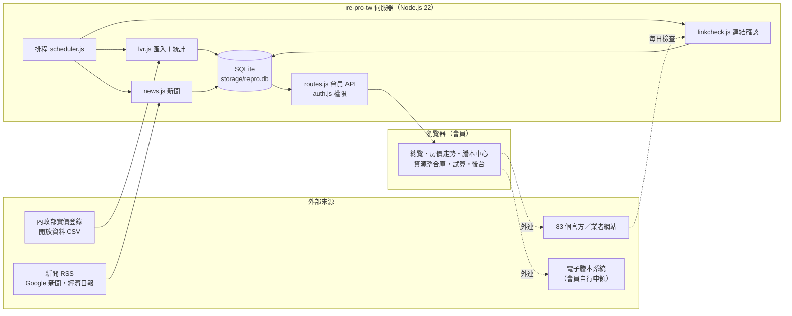
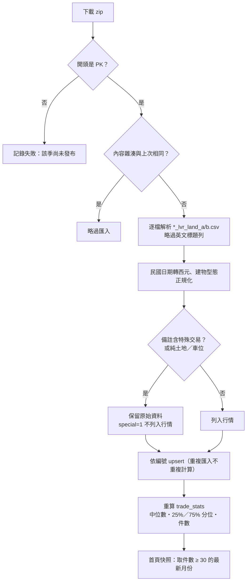
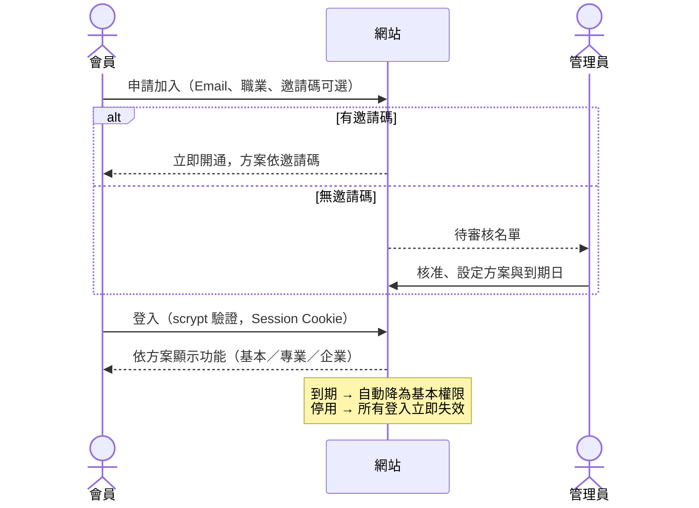
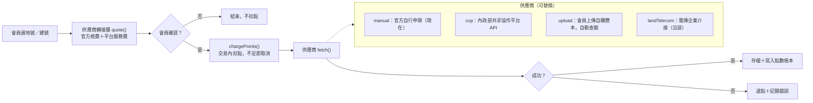
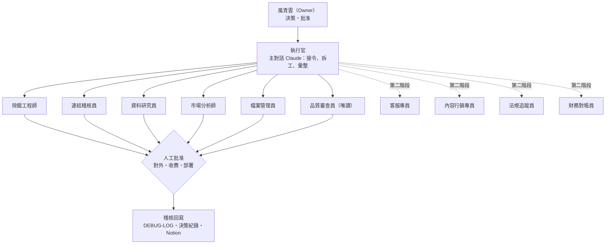
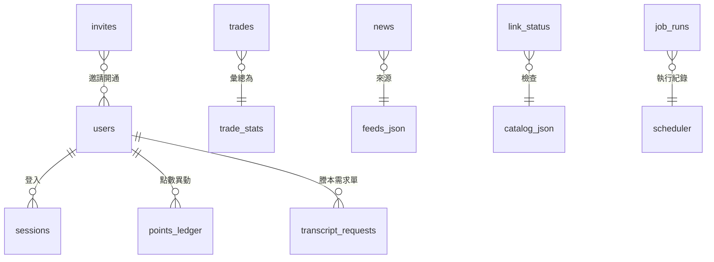
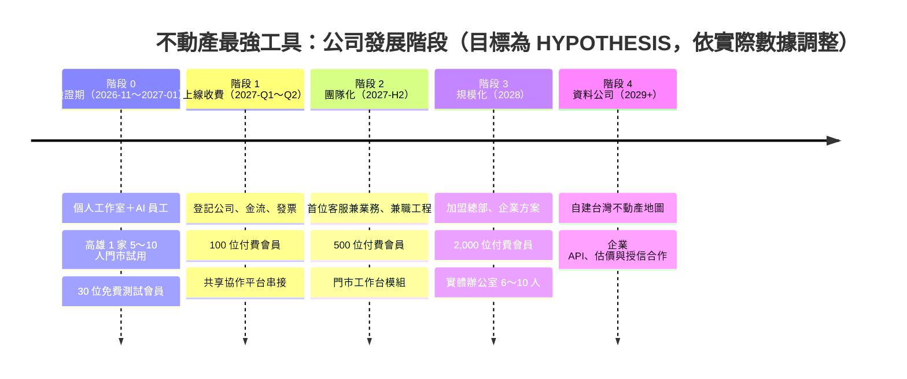

# 設計圖集

GitHub 與 Notion 都會把 mermaid 程式碼繪成圖。修改時以本檔為正本，Notion「系統設計圖與建置手冊」頁複製本檔內容。

## 圖 1：系統架構（第一階段，已上線）

## 圖 2：資料處理流程與準確度關卡

## 圖 3：會員生命週期

## 圖 4：謄本點數制（第二階段設計）

## 圖 5：AI 員工編制（沿用「風青雲 → 執行官 → 專業 AI 員工 → 人工批准 → 稽核回寫」）

## 圖 6：資料表關係

## 圖 7：公司發展階段

